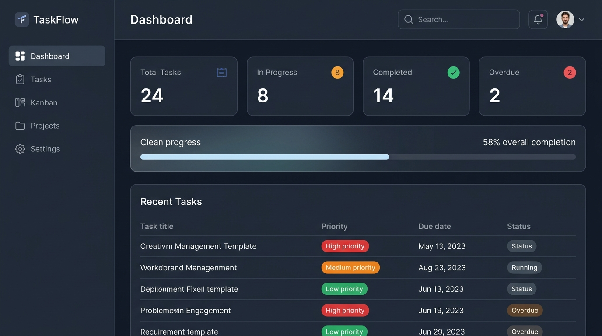
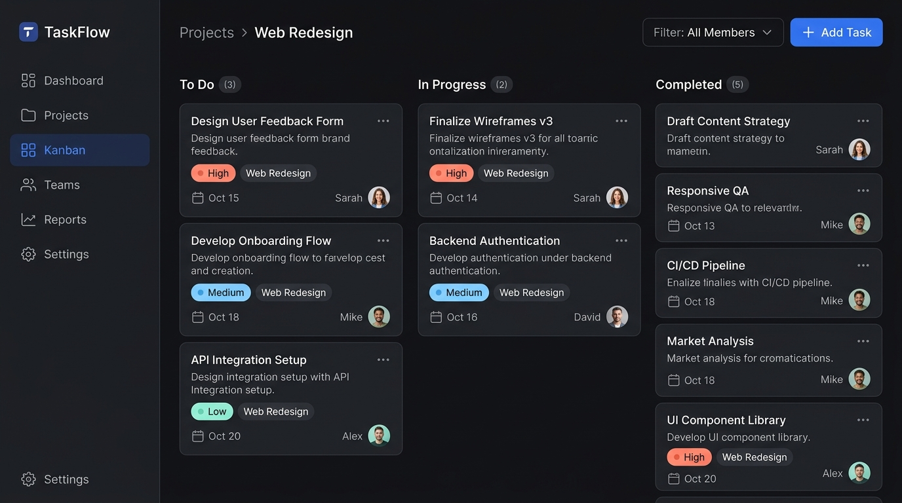
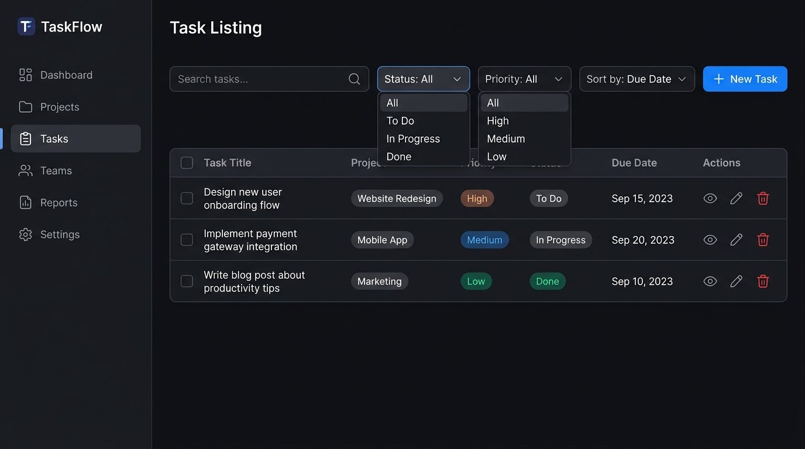
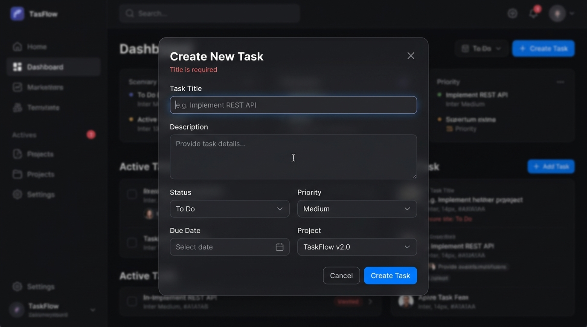
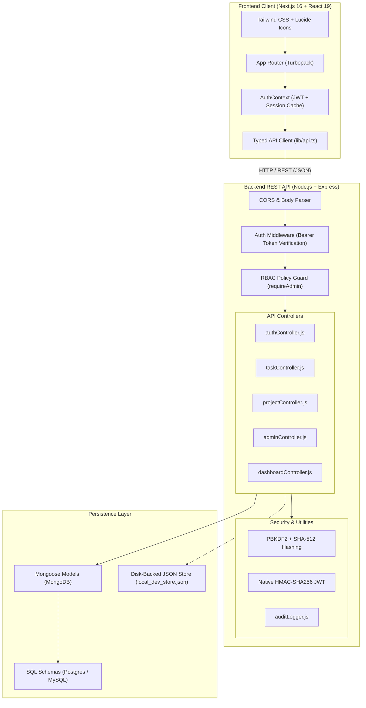

# ⚡ TaskFlow — Full-Stack Task & Project Management System

<div align="center">


[](https://nextjs.org/)
[](https://www.typescriptlang.org/)
[](https://tailwindcss.com/)
[](https://nodejs.org/)
[](https://expressjs.com/)
[](https://www.mongodb.com/)
[](https://jwt.io/)
[]()

<br />

**A modern, production-ready Task and Team Collaboration platform built with Next.js 16 (App Router), TypeScript, Tailwind CSS, and an Express.js REST API with Role-Based Access Control (RBAC), multi-user project collaboration, and security audit logging.**

[Live Demo](#-quick-start) • [Features](#-key-features) • [Screenshots](#-ui-showcase--screenshots) • [Architecture](#-system-architecture) • [API Docs](#-rest-api-reference) • [Testing](#-automated-testing--verification)

</div>

---

## 📑 Table of Contents
- [🌟 Key Features](#-key-features)
- [📸 UI Showcase & Screenshots](#-ui-showcase--screenshots)
- [🏗️ System Architecture](#-system-architecture)
- [🛡️ Security & Privacy Engineering](#-security--privacy-engineering)
- [🚀 Quick Start](#-quick-start)
  - [Prerequisites](#prerequisites)
  - [Backend Setup](#1-backend-setup)
  - [Frontend Setup](#2-frontend-setup)
- [🔑 Default Credentials](#-default-credentials)
- [📖 User & Team Workflow](#-user--team-workflow)
- [📡 REST API Reference](#-rest-api-reference)
- [🧪 Automated Testing & Verification](#-automated-testing--verification)
- [📁 Project Monorepo Structure](#-project-monorepo-structure)
- [🛠️ Troubleshooting & FAQ](#️-troubleshooting--faq)
- [📄 License & Academic Info](#-license--academic-info)

---

## 🌟 Key Features

### 👤 1. Strict User Isolation & Scoped Workspaces
* **Personal Task Scoping**: Regular members default to the **"👤 My Tasks"** view (`task.user_id === currentUserId`). Private tasks remain strictly isolated from other users.
* **Shared Project Scope**: With a single click, users toggle to **"👥 Shared Project Tasks"** to view deliverables across projects they participate in.
* **Project Boundary Isolation**: Users only see projects they **created (owner)** or were **explicitly invited to**. Unrelated projects are completely invisible.

### 👥 2. Private Team Collaboration (Invite by Email Only)
* **Zero Directory Leakage**: Strangers who register cannot view a public directory of system users.
* **Exact-Email Project Invitations**: Project owners invite teammates by typing their exact registered email address.
* **Collaborator Discovery Protection**: Regular members only see profile badges of teammates they share active projects with.

### 🛡️ 3. Multi-Layer Task Assignment Protections
* **Project Collaborator Enforcement**: Tasks inside a project can **only** be assigned to confirmed members of that specific project (`400 Bad Request` if attempting to assign to an outsider).
* **Standalone Task Isolation**: Non-project tasks can **only** be assigned to oneself (`403 Forbidden` if attempting to assign to another user).
* **Account Standing Check**: Suspended or inactive accounts are rejected by the server if targeted for task assignments.

### 📋 4. Interactive Kanban Board & Task Table
* **3-Stage Kanban Workflow**: Visual task cards across `To Do`, `In Progress`, and `Completed` columns with intuitive one-click stage movers.
* **Collaborator Indicators**: Team member badges and avatars on every card and table row.
* **Real-Time Filtering & Sorting**: Filter tasks by priority (`LOW`, `MEDIUM`, `HIGH`), status, project, or keyword search with deadline formatting.

### 👑 5. Administrator Governance Center (`/admin`)
* **Real-Time KPI Telemetry**: Live counters for total users, active accounts, suspended accounts, admins, tasks, projects, uptime, and database status.
* **User & Role Management**: Instant role toggle between `ADMIN` and `MEMBER`, account suspension/reactivation, and safe account removal with self-demotion lockout safeguards.
* **Cryptographic Admin Invitations**: Generate single-use, 48-hour secure SHA-256 hashed invite links (`/invite/[token]`) to onboard trusted administrators.
* **Immutable Security Audit Logs**: Audit trail tracking `ROLE_CHANGED`, `USER_SUSPENDED`, `ADMIN_INVITE_CREATED`, and `PASSWORD_CHANGED` with user emails, IP addresses, and timestamps.

### 💾 6. Hybrid Database & Zero-Setup Fallback Engine
* **MongoDB (Mongoose 9.1+)**: Primary document database with relationship aggregation pipelines.
* **SQL Schemas Included**: Full relational database schemas ready for PostgreSQL and MySQL (`backend/database/`).
* **Disk-Backed Dev Fallback Store**: If MongoDB is not running locally, the server seamlessly switches to an automatic file-backed JSON store (`local_dev_store.json`), allowing instant development without installing any database.

---

## 📸 UI Showcase & Screenshots

<div align="center">

### 1. Analytics & Activity Dashboard

*Real-time task counters, completion rate ring, recent assignments, and quick actions.*

<br />

### 2. Kanban Board with Scope Switcher

*Multi-stage board with assignee badges, priority tags, and My Tasks vs. Shared Project Tasks toggle.*

<br />

### 3. Comprehensive Task Table

*Searchable, filterable table with deadline alerts, project tags, and assignee avatars.*

<br />

### 4. Collaborative Task Creation Modal

*Task creation with project selection, priority levels, due date pickers, and member-scoped assignment dropdown.*

</div>

---

## 🏗️ System Architecture



---

## 🛡️ Security & Privacy Engineering

| Layer | Implementation | Security Benefit |
| :--- | :--- | :--- |
| **Password Storage** | PBKDF2 with SHA-512 (10,000 iterations + unique salt) | Protection against rainbow table attacks |
| **Session Authentication** | Native HMAC-SHA256 Signed JWT (24-hour expiration) | Stateless, tamper-proof user verification |
| **Public Registration** | Server strictly forces role to `MEMBER` | Prevents privilege escalation during self-registration |
| **Admin Provisioning** | Cryptographic SHA-256 tokens with 48h expiry (`/invite/[token]`) | Zero-leakage invitation workflow |
| **Self-Preservation Guard** | Backend blocks admin from demoting or suspending self | Prevents administrative lockout |
| **Collaborator Privacy** | `/api/auth/users` filters out non-teammates for regular members | Zero public directory harvesting by strangers |
| **Assignment Validation** | Cross-project assignee verification on create & update | Prevents task assignment to unauthorized outsiders |

---

## 🚀 Quick Start

### Prerequisites
* **Node.js**: `v18.0.0` or higher
* **npm**: `v9.0.0` or higher
* *(Optional)* **MongoDB**: If MongoDB is not running locally, the backend automatically uses its built-in disk-backed fallback store.

---

### 1. Backend Setup

```powershell
# Navigate to the backend directory
cd backend

# Install dependencies
npm install

# (Optional) Verify or configure environment variables in backend/.env
# PORT=5000
# JWT_SECRET=taskflow-super-secret-jwt-key-2026-prod
# MONGO_URI=mongodb://localhost:27017/taskflow

# Provision the default administrator account
npm run bootstrap:admin

# Start the Backend API Server
npm start
```

> 🚀 **Backend runs at**: `http://localhost:5000`  
> 📡 **Health Check**: `http://localhost:5000/api/health`

---

### 2. Frontend Setup

In a **separate terminal**:

```powershell
# Navigate to the frontend directory
cd frontend

# Install dependencies
npm install

# Start the Next.js development server
npm run dev
```

> 🌐 **Frontend runs at**: `http://localhost:3000`

---

## 🔑 Default Credentials

| Account | Email Address | Password | Role | Permissions |
| :--- | :--- | :--- | :--- | :--- |
| **System Administrator** | `admin@taskflow.local` | `Admin@123456` | `ADMIN` | Global governance, access to `/admin`, invite administrators, view audit logs. |
| **New Member** | Register at `/register` | *Any 6+ characters* | `MEMBER` | Personal task management, collaborate on invited projects. |

---

## 📖 User & Team Workflow

### 1. Personal Task Scoping
* Click **Tasks** or **Kanban** in the left sidebar.
* **`👤 My Tasks`**: Displays tasks specifically assigned to your account.
* **`👥 Shared Project Tasks`**: Displays all team deliverables within projects you are a member of.

### 2. Creating Projects & Inviting Teammates
1. Go to **Projects** → click **"+ New Project"**.
2. Enter the title, description, and optional initial collaborator emails.
3. Once created, click **"👥 Team"** on the project card.
4. Enter the teammate's exact email address under **"Invite Collaborator by Email"** and click **"Invite to Project"**.
5. The project and its tasks will immediately appear on the invited member's dashboard upon their next login.

### 3. Assigning Tasks
1. Click **"+ New Task"** anywhere in the application.
2. Select your **Project**.
3. Under **"Assign To"**, choose any confirmed project member from the dropdown.
4. When saved, the task appears directly in the teammate's **"My Tasks"** list.

### 4. Admin Governance (`/admin`)
Log in as `admin@taskflow.local` and click **Admin Panel**:
* **Overview**: View platform statistics, active vs. suspended accounts, and uptime.
* **User Management**: Promote/demote users (`ADMIN` ↔ `MEMBER`), suspend accounts, or delete users.
* **Admin Invitations**: Generate secure 48-hour single-use links (`/invite/[token]`) for new administrators.
* **Security Audit Logs**: Inspect chronological event logs with IP addresses, actions, and timestamps.

---

## 📡 REST API Reference

### 🔐 Authentication (`/api/auth`)
| Method | Endpoint | Access | Description |
| :--- | :--- | :--- | :--- |
| `POST` | `/api/auth/register` | Public | Register new member account (`MEMBER` role only) |
| `POST` | `/api/auth/login` | Public | Authenticate user & receive JWT token |
| `POST` | `/api/auth/accept-invite` | Public | Accept admin invite with cryptographic token |
| `GET` | `/api/auth/me` | Authenticated | Fetch current profile |
| `PUT` | `/api/auth/profile` | Authenticated | Update user name or avatar |
| `PUT` | `/api/auth/change-password` | Authenticated | Update account password |
| `GET` | `/api/auth/users` | Authenticated | Fetch confirmed team collaborators |

### 📁 Projects (`/api/projects`)
| Method | Endpoint | Access | Description |
| :--- | :--- | :--- | :--- |
| `GET` | `/api/projects` | Authenticated | List accessible projects (user-scoped) |
| `POST` | `/api/projects` | Authenticated | Create new project (caller becomes owner) |
| `GET` | `/api/projects/:id` | Authenticated | Get project details (members/admin only) |
| `PUT` | `/api/projects/:id` | Authenticated | Update project details (owner/admin only) |
| `POST` | `/api/projects/:id/members`| Authenticated | Invite collaborator by email (owner/admin only) |
| `DELETE`| `/api/projects/:id/members/:userId` | Authenticated | Remove collaborator from project |
| `DELETE`| `/api/projects/:id` | Authenticated | Delete project and cascade-delete its tasks |

### 📋 Tasks (`/api/tasks`)
| Method | Endpoint | Access | Description |
| :--- | :--- | :--- | :--- |
| `GET` | `/api/tasks` | Authenticated | List tasks (`?scope=my_tasks` or `all_shared`) |
| `POST` | `/api/tasks` | Authenticated | Create task with assignment validation |
| `GET` | `/api/tasks/:id` | Authenticated | View task details |
| `PUT` | `/api/tasks/:id` | Authenticated | Update task status, priority, or assignee |
| `DELETE`| `/api/tasks/:id` | Authenticated | Delete task |

### 👑 Admin Governance (`/api/admin`)
| Method | Endpoint | Access | Description |
| :--- | :--- | :--- | :--- |
| `GET` | `/api/admin/stats` | Admin Only | System telemetry & KPI counters |
| `GET` | `/api/admin/users` | Admin Only | Directory of all users with task counts |
| `PATCH`| `/api/admin/users/:id/role` | Admin Only | Promote or demote user role |
| `PATCH`| `/api/admin/users/:id/status` | Admin Only | Suspend or reactivate user account |
| `DELETE`| `/api/admin/users/:id` | Admin Only | Delete user account |
| `GET` | `/api/admin/invitations` | Admin Only | List active and consumed invitations |
| `POST` | `/api/admin/invitations` | Admin Only | Create new 48-hour administrator invitation |
| `DELETE`| `/api/admin/invitations/:id` | Admin Only | Revoke invitation token |
| `GET` | `/api/admin/audit-logs` | Admin Only | Fetch security audit trail |

---

## 🧪 Automated Testing & Verification

The backend includes a comprehensive, automated in-process test suite covering authentication, project isolation, assignment protections, and all admin operations:

```powershell
cd backend
node test-controllers-direct.js
```

### Test Suite Results (24/24 Passed)
```text
🧪 Starting Direct In-Process Controller & Model Scoping Tests...

  ✅ PASS: Alice registers successfully as MEMBER
  ✅ PASS: Bob registers successfully as MEMBER
  ✅ PASS: Alice creates a new project
  ✅ PASS: Bob CANNOT see Alice's project (strict project isolation)
  ✅ PASS: Alice adds Bob as collaborator to her project
  ✅ PASS: Bob can now access and work on the shared project!
  ✅ PASS: Alice creates a task assigned to herself
  ✅ PASS: Alice creates a task assigned to Bob in shared project
  ✅ PASS: Bob ONLY sees tasks assigned to him in My Tasks view
  ✅ PASS: Collaborators can view all shared project tasks
  ✅ PASS: Protection 1: Cannot assign standalone task to another user (403 Forbidden)
  ✅ PASS: Protection 2: Cannot assign project task to non-member outsider (400 Bad Request)
  ✅ PASS: Protection 3: Cannot reassign existing task to non-member outsider (400 Bad Request)
  ✅ PASS: Admin logs into administrative system
  ✅ PASS: Admin Panel 1: Overview stats endpoint works
  ✅ PASS: Admin Panel 2: User management list works
  ✅ PASS: Admin Panel 2b: Promote user to ADMIN works
  ✅ PASS: Admin Panel 2b: Demote user to MEMBER works
  ✅ PASS: Admin Panel 2c: Suspend account works
  ✅ PASS: Admin Panel 2c: Reactivate account works
  ✅ PASS: Admin Panel 3: Create administrator invitation works
  ✅ PASS: Invited user accepts token and gets activated as ADMIN
  ✅ PASS: Admin Panel 3: Revoke invitation works
  ✅ PASS: Admin Panel 4: Security Audit Logs work

======================================================
🎉 ALL TESTS PASSED: 24/24 assertions succeeded!
======================================================
```

### Frontend TypeScript Verification
```powershell
cd frontend
npx tsc --noEmit
```
*(Exits with code 0 — 0 TypeScript errors).*

---

## 📁 Project Monorepo Structure

```
pawani/
├── backend/
│   ├── config/
│   │   └── db.js                 # Mongoose schemas & disk-backed fallback engine
│   ├── controllers/
│   │   ├── adminController.js     # Admin metrics, user RBAC, invites, audit logs
│   │   ├── authController.js      # Auth, profile, team member lookup
│   │   ├── dashboardController.js # Scoped dashboard stats
│   │   ├── projectController.js   # Project CRUD & email-based member management
│   │   └── taskController.js      # Task CRUD, assignment protection & scoping
│   ├── database/
│   │   ├── postgres_schema.sql    # PostgreSQL schema with JSONB members
│   │   └── schema.sql             # Relational MySQL table definitions
│   ├── middleware/
│   │   ├── authMiddleware.js      # JWT authentication & requireAdmin guard
│   │   ├── errorHandler.js        # Global error & 404 response handlers
│   │   └── validateTask.js        # Request payload validation
│   ├── models/
│   │   ├── projectModel.js        # Project data access & collaborator logic
│   │   ├── taskModel.js           # Task data access & scoping rules
│   │   └── userModel.js           # User data access, PBKDF2 hashing, invitations
│   ├── routes/
│   │   ├── adminRoutes.js         # /api/admin/* endpoints
│   │   ├── authRoutes.js          # /api/auth/* endpoints
│   │   ├── dashboardRoutes.js     # /api/dashboard/* endpoints
│   │   ├── projectRoutes.js       # /api/projects/* endpoints
│   │   └── taskRoutes.js          # /api/tasks/* endpoints
│   ├── scripts/
│   │   └── bootstrap-admin.js     # Admin provisioning CLI script
│   ├── utils/
│   │   ├── auditLogger.js         # Security audit logging engine
│   │   └── auth.js                # PBKDF2 password hashing & native JWT
│   ├── server.js                  # Express application entry point
│   └── test-controllers-direct.js # 24-assertion integration test suite
│
├── frontend/
│   ├── src/
│   │   ├── app/
│   │   │   ├── admin/             # Administrator Governance Center & subpages
│   │   │   ├── invite/[token]/    # Admin invitation acceptance portal
│   │   │   ├── kanban/            # Kanban board with Scope Switcher
│   │   │   ├── login/             # User login page
│   │   │   ├── profile/           # User profile & password settings
│   │   │   ├── projects/          # Projects list & Email Invitation modal
│   │   │   ├── register/          # Public member registration
│   │   │   ├── tasks/             # Task listing table with Scope Switcher
│   │   │   ├── layout.tsx         # Root layout with AppShell
│   │   │   └── page.tsx           # Main analytics dashboard
│   │   ├── components/
│   │   │   ├── layout/            # AppShell, Navbar, Sidebar
│   │   │   ├── tasks/             # TaskTable, KanbanBoard, TaskFormModal, TaskDetailsModal
│   │   │   └── ui/                # StatCard, DeleteDialog
│   │   ├── context/
│   │   │   └── AuthContext.tsx    # Global auth provider with resilient session recovery
│   │   ├── lib/
│   │   │   └── api.ts             # Typed API client with Bearer token injection
│   │   └── types/
│   │       ├── auth.ts            # User, Role, AdminStats, AuditLog interfaces
│   │       └── task.ts            # Task, Project, ProjectMember interfaces
│   └── package.json
│
├── docs/
│   ├── screenshots/              # High-resolution application screenshots
│   ├── TaskFlow showcase.png     # Full-featured UI presentation showcase
│   └── readme.md                 # Original development requirements & evaluation rubric
│
├── .gitignore                    # Comprehensive ignore rules (.env, build artifacts, etc.)
└── README.md                     # Complete project documentation
```

---

## 🛠️ Troubleshooting & FAQ

#### Q: The browser shows "Cannot connect to TaskFlow server. Please ensure the backend is running at http://localhost:5000".
* **Reason**: The frontend is trying to connect to the backend API, but the backend server is stopped.
* **Solution**: Open a separate terminal, navigate to `backend/`, and run `npm start`.

#### Q: MongoDB is not installed on my computer. Can I still run this project?
* **Yes!** The backend includes an automated **Disk-Backed Development Fallback Store** (`local_dev_store.json`). It runs immediately, persists all registered users and tasks across server restarts, and requires zero external database installation.

#### Q: How do I provision or reset the default administrator account?
* In the `backend/` directory, run:
  ```powershell
  npm run bootstrap:admin
  ```
  *(Default: `admin@taskflow.local` / `Admin@123456`)*

#### Q: Why can't I see other registered members in the task assignment dropdown?
* **Privacy by Design**: To prevent directory harvesting by strangers, members can only assign tasks to **confirmed collaborators of the selected project**. Once you add a member to your project via **Invite Collaborator by Email**, they immediately appear in the assignee list for that project.

---


